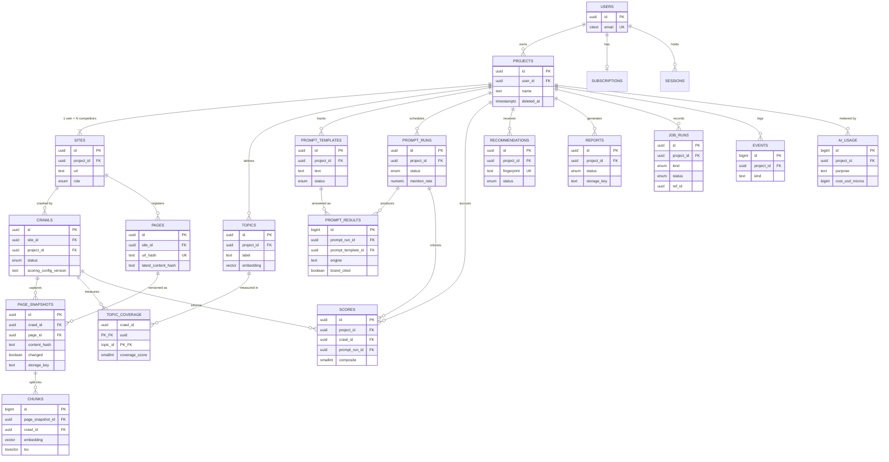

# GEOlens — PostgreSQL Schema Design

**Author:** Database Architecture
**Status:** Design review draft
**Pairs with:** PRD v1.0, Backend Architecture doc
**Stack:** PostgreSQL (managed) + pgvector + FTS, Prisma with raw-SQL escape hatch

---

## 1. Global Design Principles

These rules apply to every table and explain most decisions below:

1. **Primary keys:** UUID for domain entities (safe to expose in URLs/APIs), `bigint` identity for high-volume append tables (`chunks`, `prompt_results`, `ai_usage`, `events`) where index size and insert speed matter. UUIDs are generated app-side as **UUIDv7** (time-ordered) so B-tree inserts stay right-leaning instead of splattering across the index — this matters most for `page_snapshots`.
2. **Naming:** snake_case tables/columns in Postgres, camelCase in Prisma via `@map`/`@@map`. The database is the source of truth for naming.
3. **JSONB policy:** anything queried, filtered, aggregated, or charted gets a real column. Anything that is evolving payload (extraction artifacts, evidence refs, per-engine metric breakdowns) is JSONB. This keeps migration churn low without turning Postgres into MongoDB.
4. **Enum policy:** Postgres enums for closed sets we control (statuses, priorities). Plain `text` for open sets that grow with the market — **engine names are text**, because adding "the next AI engine" must never require a migration.
5. **Denormalized `project_id`:** nearly every query in the product is project-scoped, so hot child tables carry `project_id` directly instead of joining up the chain. Consistency is enforced by the service layer (the value is always derived server-side, never accepted from clients), with a strict composite-FK option documented in §6 for later hardening.
6. **Deletion policy:** `projects` soft-delete (`deleted_at`) → a background purge job does **batched** child deletes and R2 cleanup within the 30-day SLA. Hard cascades on a project with 50k snapshot rows would lock tables at exactly the moment a user is watching. Exception: `ai_usage` is a financial ledger — rows survive purges with refs nulled.
7. **Money:** integer micro-USD (`bigint`). Never floats for money; `numeric` reserved for rates/percentages.
8. **Timestamps:** `timestamptz` everywhere, `created_at` on everything, `updated_at` only where rows mutate.
9. **Immutability:** `crawls`, `page_snapshots`, `prompt_runs`, `prompt_results`, `scores`, `events`, `ai_usage` are write-once (status fields aside). Trust in the product depends on evidence that can't be silently rewritten.
10. **SQL-only features:** partial unique indexes, expression indexes, CHECK constraints, GIN/HNSW/BRIN, and extensions can't be expressed in Prisma schema. They live in hand-edited migrations (§6) — a documented, deliberate list, not an accident.

### Two refinements vs. the backend architecture doc

- **`sites` table introduced.** The backend doc hand-waved "a competitor is a project flagged `is_competitor`." Modeled properly: a `project` owns **sites** (`role = OWN | COMPETITOR`). One crawl pipeline, one FK target for crawls, and V2's "multiple competitors" becomes *insert another row* instead of a schema change. Plan limits count projects, not sites — cleaner everywhere.
- **Vector index strategy corrected.** Retrieval is always scoped to one crawl (~3,000 chunks). Exact cosine scan over 3k rows is single-digit milliseconds — **no vector index needed on the hot path**. The global HNSW index is deferred until a cross-corpus feature (industry benchmarks) exists. This sidesteps pgvector's filtered-ANN recall headaches entirely at MVP.

---

## 2. Entity Reference

Types shown as Postgres types. FK = foreign key. All tables have `created_at timestamptz default now()` (not repeated below).

### 2.1 `users`

Identity. Better Auth manages auth flows; these tables are its storage, owned by us in our Postgres (the reason we chose it).

| Column | Type | Notes |
|---|---|---|
| id | uuid PK | |
| email | citext | UNIQUE — citext gives case-insensitive uniqueness without lower() gymnastics |
| name, image_url | text null | |
| password_hash | text null | null for OAuth-only users |
| email_verified_at | timestamptz null | |
| updated_at | timestamptz | |

**Relationships:** 1→N `projects`, `sessions`, `oauth_accounts`; 1→0..1 `subscriptions`.
**Reasoning:** citext beats a `lower(email)` expression index for readability and Prisma support. Password nullable, not empty-string — absence is a state.

### 2.2 `sessions` / `oauth_accounts`

| sessions | | oauth_accounts | |
|---|---|---|---|
| id uuid PK | | id uuid PK | |
| user_id FK→users | cascade | user_id FK→users | cascade |
| token text UNIQUE | | provider text | |
| expires_at timestamptz | | provider_account_id text | |
| ip, user_agent text null | | | UNIQUE(provider, provider_account_id) |

**Reasoning:** DB-backed sessions (revocable, auditable) per the auth decision. Index on `sessions(user_id)` and `(expires_at)` for the cleanup job.

### 2.3 `subscriptions`

| Column | Type | Notes |
|---|---|---|
| id | uuid PK | |
| user_id | uuid FK→users | UNIQUE — one subscription per user at MVP |
| stripe_customer_id | text | UNIQUE |
| stripe_subscription_id | text null | UNIQUE |
| plan | enum(FREE, PRO) | default FREE |
| status | enum(TRIALING, ACTIVE, PAST_DUE, CANCELED) | |
| current_period_end | timestamptz null | |
| updated_at | timestamptz | |

**Reasoning:** entitlements resolve from this row server-side on every enforcement point. Stripe IDs unique so webhook upserts are idempotent by construction.

### 2.4 `projects`

| Column | Type | Notes |
|---|---|---|
| id | uuid PK | |
| user_id | uuid FK→users | cascade |
| name | text | |
| status | enum(ACTIVE, ARCHIVED) | |
| timezone | text default 'UTC' | weekly runs land in the user's morning, not 3am |
| deleted_at | timestamptz null | soft delete → purge job |
| updated_at | timestamptz | |

**Indexes:** `(user_id)`; partial `(user_id) WHERE deleted_at IS NULL` backs every list query.
**Reasoning:** the tenancy root. Everything below hangs off it directly or transitively; the ownership guard resolves `session → user → project` against this table once per request.

### 2.5 `sites` — the Competitors entity

| Column | Type | Notes |
|---|---|---|
| id | uuid PK | |
| project_id | uuid FK→projects | cascade |
| url | text | normalized (scheme, host case, trailing slash) |
| domain | text | extracted — crawler politeness groups by this |
| role | enum(OWN, COMPETITOR) | |
| name | text null | display label |

**Constraints:** UNIQUE `(project_id, url)`; **partial unique** `(project_id) WHERE role = 'OWN'` — the database itself guarantees exactly one primary site per project.
**Reasoning:** competitors are not second-class objects; they're sites crawled by the identical pipeline (PRD FR-A2: "same pipeline"). The partial unique index turns a business invariant into a constraint no code bug can violate. Competitor *count* limits are plan-dependent → enforced in the service layer, not the schema.

### 2.6 `crawls`

One row per crawl run — the snapshot anchor for everything derived.

| Column | Type | Notes |
|---|---|---|
| id | uuid PK | |
| site_id | uuid FK→sites | cascade |
| project_id | uuid FK→projects | denormalized (principle 5) |
| status | enum(QUEUED, CRAWLING, ANALYZING, COMPLETED, COMPLETED_DEGRADED, FAILED, CANCELED) | |
| trigger | enum(MANUAL, SCHEDULED) | priority + billing analytics |
| pages_discovered / pages_crawled / pages_changed / pages_failed | int default 0 | |
| degradation | jsonb null | e.g. `{"budget": true, "provider:gemini": true}` |
| error_reason | text null | the human-readable reason (NFR) |
| ai_cost_usd_micros | bigint default 0 | rollup from `ai_usage` |
| scoring_config_version / pipeline_version | text | what produced this crawl's numbers |
| queued_at / started_at / finished_at | timestamptz | |

**Indexes:** `(project_id, created_at DESC)`, `(site_id, created_at DESC)`; **partial unique** `(site_id) WHERE status IN ('QUEUED','CRAWLING','ANALYZING')` — the overlap guard as a constraint, not a hope.
**Reasoning:** COMPLETED_DEGRADED is a first-class status because "partial results, never blank" is an NFR — the UI can render a banner from the status alone. Version columns are what make "why did my score change" answerable a year later.

### 2.7 `pages`

Canonical URL registry per site — identity that persists across crawls.

| Column | Type | Notes |
|---|---|---|
| id | uuid PK | |
| site_id | uuid FK→sites | cascade |
| url | text | |
| url_hash | text | sha256 hex of normalized URL |
| latest_content_hash | text null | the change-detection comparator |
| first_seen_at / last_seen_at | timestamptz | |

**Constraints:** UNIQUE `(site_id, url_hash)` — hashing sidesteps B-tree limits on multi-KB URLs and keeps the index compact.
**Reasoning:** separating page *identity* from page *state* is what makes per-page history ("this page across 12 crawls") a simple query. `latest_content_hash` lives here so the crawler answers "changed?" with one indexed lookup before any expensive work — the single biggest cost lever in the system. (An earlier sketch had a `latest_snapshot_id` pointer; dropped — it created a circular FK and the hash is all change detection needs.)

### 2.8 `page_snapshots` — the Snapshots entity

Per-crawl page state. The largest, fastest-growing table.

| Column | Type | Notes |
|---|---|---|
| id | uuid PK | UUIDv7 (principle 1) — this table is why |
| crawl_id | uuid FK→crawls | cascade |
| page_id | uuid FK→pages | cascade |
| http_status | smallint null | |
| content_hash | text | |
| changed | boolean | false ⇒ analysis carried forward |
| carried_forward_from_id | uuid null self-FK | lineage of reused analysis |
| title | text null | column: it's displayed/sorted |
| word_count | int null | column: charted |
| published_at / page_updated_at | timestamptz null | freshness scoring |
| has_structured_data | boolean default false | |
| internal_link_count / external_link_count | int null | link-graph inputs |
| quality_score | smallint null | null = not in the sampled set |
| extracted | jsonb | heading outline, meta, schema payloads, alt coverage… |
| quality | jsonb null | rubric detail behind quality_score |
| storage_key | text | R2 key of gzipped raw HTML |
| fetched_at | timestamptz | |

**Constraints/Indexes:** UNIQUE `(crawl_id, page_id)`; `(page_id, created_at DESC)` for page history.
**Reasoning:** `carried_forward_from_id` makes change-detection auditable — evidence views can say "this analysis is from the June 14 crawl" instead of silently reusing data. Columns vs JSONB split follows principle 3 exactly. Partition-by-month candidate #1 (§7).

### 2.9 `chunks` — the Embeddings entity

| Column | Type | Notes |
|---|---|---|
| id | bigint identity PK | volume table (principle 1) |
| page_snapshot_id | bigint? No — uuid FK→page_snapshots | cascade |
| crawl_id | uuid FK→crawls | **denormalized: retrieval filters on this** |
| ordinal | int | position within page |
| heading_path | text null | "H1 > H2" breadcrumb — becomes citation context |
| content | text | |
| token_count | int | budget math |
| embedding | vector(1536) null | text-embedding-3-small; null until the embed batch lands |
| tsv | tsvector null | set in the raw INSERT: `to_tsvector('english', content)` |

**Indexes:** `(crawl_id)`; `GIN(tsv)`; HNSW on `embedding` **deferred** (see refinement note §1).
**Reasoning:** nullable `embedding` enables the two-phase write (chunk rows first, embedding batch second) without a staging table. `tsv` is a plain column filled at insert time rather than a generated column — chunks are inserted via raw SQL anyway (Prisma can't write vectors), and this avoids Prisma-migration drift games with `GENERATED ALWAYS`. Boring and correct.

### 2.10 `topics`

| Column | Type | Notes |
|---|---|---|
| id | uuid PK | |
| project_id | uuid FK→projects | cascade |
| label | text | |
| description | text null | |
| embedding | vector(1536) null | topic centroid for chunk→topic mapping |
| source | enum(GENERATED, USER) | |
| status | enum(ACTIVE, ARCHIVED) | archive, never delete — coverage history references these |
| position | int | user-controlled ordering |
| updated_at | timestamptz | |

**Constraints:** expression unique `(project_id, lower(label)) WHERE status='ACTIVE'` (SQL-only).
**Reasoning:** taxonomy is per-project and user-editable (PRD FR-5.1), so `source` distinguishes generated vs. human rows. Archiving instead of deleting preserves historical `topic_coverage` integrity.

### 2.11 `topic_coverage`

| Column | Type | Notes |
|---|---|---|
| crawl_id | uuid FK→crawls | cascade |
| topic_id | uuid FK→topics | restrict |
| coverage_score | smallint | 0–100, CHECK-constrained |
| depth_chunks | int | how much content backs it |
| evidence | jsonb | top matching chunk ids |

**Constraints:** composite **PK `(crawl_id, topic_id)`** — a coverage fact exists at most once per crawl per topic, and the PK *is* the query pattern.
**Reasoning:** missing-topics = a self-join across two crawls (own site's latest vs competitor's latest) comparing coverage_score — pure SQL, no application gymnastics. `restrict` on topic delete forces the archive workflow.

### 2.12 `prompt_templates`

| Column | Type | Notes |
|---|---|---|
| id | uuid PK | |
| project_id | uuid FK→projects | cascade |
| text | text | the prompt itself |
| intent | text null | 'comparison' / 'recommendation' / 'howto' — open set, so text |
| source | enum(GENERATED, USER) | |
| pinned | boolean default false | |
| status | enum(ACTIVE, ARCHIVED) | archive, never delete — results reference these |
| position | int | |
| updated_at | timestamptz | |

**Constraints:** expression unique `(project_id, md5(text)) WHERE status='ACTIVE'` (SQL-only) — no duplicate active prompts, without indexing multi-KB text.
**Reasoning:** "templates" because V2 adds variable substitution ({city}, {competitor}); the name buys that future without a rename. Plan limit (10 active) is app-enforced — it varies by plan.

### 2.13 `prompt_runs`

| Column | Type | Notes |
|---|---|---|
| id | uuid PK | |
| project_id | uuid FK→projects | cascade |
| trigger | enum(MANUAL, SCHEDULED) | |
| status | enum(QUEUED, RUNNING, COMPLETED, COMPLETED_DEGRADED, FAILED) | |
| engines | text[] | which engines this run covered |
| mention_rate / citation_share | numeric(5,2) null | columns: these are the two charted lines |
| metrics | jsonb null | per-engine breakdown, share-of-voice vs competitors |
| ai_cost_usd_micros | bigint default 0 | |
| started_at / finished_at | timestamptz null | |

**Indexes:** `(project_id, created_at DESC)`; partial unique `(project_id) WHERE status IN ('QUEUED','RUNNING')` — no overlapping runs.
**Reasoning:** immutable run snapshots are what make trend charts honest; nothing recomputes history. Overall rates as real columns (charted), everything multidimensional in `metrics`.

### 2.14 `prompt_results`

One row per (prompt × engine × sample) — the evidence layer.

| Column | Type | Notes |
|---|---|---|
| id | bigint identity PK | volume table |
| prompt_run_id | uuid FK→prompt_runs | cascade |
| prompt_template_id | uuid FK→prompt_templates | **restrict** |
| engine | text | open set (principle 4) |
| sample_index | smallint | multi-sample averaging (NFR) |
| brand_mentioned / brand_cited | boolean | |
| mention_position | smallint null | rank within answer |
| sentiment | enum null | P1 feature, column ready |
| competitors_mentioned | jsonb null | `[{name, cited}]` |
| citations | jsonb null | URLs the engine returned |
| answer_text | text null | full answer inline — a few KB; evidence views need it hot, R2 would be an indirection tax |
| model | text | exact model string that answered |
| latency_ms | int null | |
| error | text null | per-cell failure without failing the run |

**Constraints/Indexes:** UNIQUE `(prompt_run_id, prompt_template_id, engine, sample_index)` — idempotent job retries can never double-insert; `(prompt_template_id, created_at)` for per-prompt trend views.
**Reasoning:** the uniqueness constraint is the idempotency mechanism (queue design rule from the backend doc, enforced here). `restrict` on template delete is why templates archive instead.

### 2.15 `scores`

Immutable score computations — a new row whenever either input (crawl or prompt run) updates.

| Column | Type | Notes |
|---|---|---|
| id | uuid PK | |
| project_id | uuid FK→projects | cascade |
| crawl_id | uuid null FK→crawls | the crawl input used |
| prompt_run_id | uuid null FK→prompt_runs | the citation input used |
| composite | smallint | 0–100 CHECK |
| score_citation / score_retrievability / score_content_quality / score_topic_coverage / score_technical / score_trust | smallint null | null = component degraded/unavailable |
| components | jsonb | weights + evidence refs per component |
| scoring_config_version | text | |

**Constraints:** CHECK `(crawl_id IS NOT NULL OR prompt_run_id IS NOT NULL)`; range CHECKs on all score columns.
**Indexes:** `(project_id, created_at DESC)` — the trend chart query.
**Reasoning:** scores reference *both* inputs because the composite blends crawl-derived components with prompt-run-derived citation performance; recording exactly which crawl + which run produced each number is what makes every historical point reproducible. Six real columns because the dashboard charts each sub-score (principle 3).

### 2.16 `recommendations`

| Column | Type | Notes |
|---|---|---|
| id | uuid PK | |
| project_id | uuid FK→projects | cascade |
| fingerprint | text | stable hash of (type + target) |
| source | enum(RULE, AI) | |
| rule_key | text null | which rule fired |
| title / body | text | |
| priority | enum(CRITICAL, HIGH, MEDIUM, LOW) | |
| impact / difficulty | smallint | 1–5 CHECK |
| status | enum(OPEN, DONE, DISMISSED, VALIDATED, REGRESSED) | |
| evidence | jsonb | page/snapshot/prompt_result/check refs |
| first_seen_crawl_id / last_seen_crawl_id | uuid null FK→crawls, SET NULL | |
| resolved_at | timestamptz null | |
| updated_at | timestamptz | |

**Constraints/Indexes:** **UNIQUE `(project_id, fingerprint)`** — the dedupe mechanism; `(project_id, status)`.
**Reasoning:** the fingerprint makes recommendations *entities with a lifecycle* rather than per-crawl noise: the same issue found again updates `last_seen_crawl_id` instead of duplicating, and PRD's V2 validation loop (DONE → next crawl → VALIDATED/REGRESSED) is just status transitions on rows that already exist. Recs outlive their originating crawl, hence SET NULL not cascade.

### 2.17 `reports`

| Column | Type | Notes |
|---|---|---|
| id | uuid PK | |
| project_id | uuid FK→projects | cascade |
| kind | enum(ON_DEMAND, SCHEDULED) | |
| status | enum(QUEUED, GENERATING, READY, FAILED) | |
| crawl_id / prompt_run_id | uuid null, SET NULL | what the report captured |
| params | jsonb null | date range, sections toggled |
| storage_key | text null | R2 PDF key |
| size_bytes | int null | |
| generated_at | timestamptz null | |

**Indexes:** `(project_id, created_at DESC)`.
**Reasoning:** reports are pointers to immutable inputs plus a rendered artifact — regeneration is always possible from the referenced snapshot data even after the PDF ages out of R2.

### 2.18 `job_runs` — the Job Status entity

Durable execution record. BullMQ/Redis is the ephemeral engine; this table is the audit trail that survives Redis flushes and powers the ops dashboard.

| Column | Type | Notes |
|---|---|---|
| id | uuid PK | |
| project_id | uuid null FK→projects, SET NULL | null for system jobs (cleanup, rollups) |
| kind | enum(CRAWL, PROMPT_SIM, REPORT, DIGEST, CLEANUP, ROLLUP) | |
| ref_id | uuid null | soft ref → crawl/run/report id |
| queue | text | |
| bullmq_job_id | text null | correlation into Bull Board |
| status | enum(QUEUED, ACTIVE, COMPLETED, FAILED, DELAYED, CANCELED) | |
| attempts | smallint default 0 | |
| progress | jsonb null | last progress snapshot |
| error | text null | |
| queued_at / started_at / finished_at | timestamptz | |

**Indexes:** `(project_id, created_at DESC)`; `(kind, status)`; partial `(status) WHERE status IN ('QUEUED','ACTIVE')` for the live ops view.
**Reasoning:** `ref_id` is deliberately a soft reference, not an FK — this is an operations/audit table spanning six job kinds, and a polymorphic hard-FK web would couple ops plumbing to every domain table. Domain integrity lives in the domain tables; this table observes.

### 2.19 `ai_usage`

The metering ledger. Append-only, survives project purges (refs nulled).

| Column | Type | Notes |
|---|---|---|
| id | bigint identity PK | |
| project_id / crawl_id / prompt_run_id | uuid null, SET NULL | |
| purpose | text | 'taxonomy', 'page_quality', 'exec_summary', 'prompt_sim', 'embedding', 'mention_judge'… |
| provider / model | text | |
| input_tokens / output_tokens / cached_input_tokens | int | |
| cost_usd_micros | bigint | |
| latency_ms | int null | |

**Indexes:** `(project_id, created_at)`, `(crawl_id)`, **BRIN `(created_at)`** — append-only time-series is exactly what BRIN exists for; near-zero index size for the hourly rollup scans.
**Reasoning:** every COGS question ("which purpose burns money?", "which project is unprofitable?") is a GROUP BY on this table. The gateway writes it; nothing else may.

### 2.20 `events`

Append-only feed behind History's "what changed."

| Column | Type | Notes |
|---|---|---|
| id | bigint identity PK | |
| project_id | uuid FK→projects | cascade |
| kind | text | 'score_changed', 'citation_lost', 'pages_stale', 'rec_validated'… open set |
| payload | jsonb | |
| crawl_id / prompt_run_id | uuid null, SET NULL | provenance |

**Indexes:** `(project_id, created_at DESC)`; BRIN `(created_at)`.
**Reasoning:** a feed, not an event-sourcing store (explicit non-goal in the backend doc) — the aggregate step *derives* events from state deltas and appends here. Cursor pagination target #1.

---

## 3. ER Diagram (Mermaid)



---

## 4. Prisma Schema

```prisma
generator client {
  provider        = "prisma-client-js"
  previewFeatures = ["postgresqlExtensions"]
}

datasource db {
  provider   = "postgresql"
  url        = env("DATABASE_URL")
  extensions = [citext, pgcrypto, vector]
}

// ───────────────────────── Enums ─────────────────────────

enum PlanTier {
  FREE
  PRO
}

enum SubscriptionStatus {
  TRIALING
  ACTIVE
  PAST_DUE
  CANCELED
}

enum ProjectStatus {
  ACTIVE
  ARCHIVED
}

enum SiteRole {
  OWN
  COMPETITOR
}

enum CrawlStatus {
  QUEUED
  CRAWLING
  ANALYZING
  COMPLETED
  COMPLETED_DEGRADED
  FAILED
  CANCELED
}

enum RunTrigger {
  MANUAL
  SCHEDULED
}

enum PromptRunStatus {
  QUEUED
  RUNNING
  COMPLETED
  COMPLETED_DEGRADED
  FAILED
}

enum GeneratedSource {
  GENERATED
  USER
}

enum ArchivableStatus {
  ACTIVE
  ARCHIVED
}

enum Sentiment {
  POSITIVE
  NEUTRAL
  NEGATIVE
}

enum RecSource {
  RULE
  AI
}

enum RecPriority {
  CRITICAL
  HIGH
  MEDIUM
  LOW
}

enum RecStatus {
  OPEN
  DONE
  DISMISSED
  VALIDATED
  REGRESSED
}

enum ReportKind {
  ON_DEMAND
  SCHEDULED
}

enum ReportStatus {
  QUEUED
  GENERATING
  READY
  FAILED
}

enum JobKind {
  CRAWL
  PROMPT_SIM
  REPORT
  DIGEST
  CLEANUP
  ROLLUP
}

enum JobStatus {
  QUEUED
  ACTIVE
  COMPLETED
  FAILED
  DELAYED
  CANCELED
}

// ─────────────────────── Identity ────────────────────────

model User {
  id              String    @id @default(uuid()) @db.Uuid // app supplies UUIDv7
  email           String    @unique @db.Citext
  name            String?
  imageUrl        String?   @map("image_url")
  passwordHash    String?   @map("password_hash")
  emailVerifiedAt DateTime? @map("email_verified_at") @db.Timestamptz(6)
  createdAt       DateTime  @default(now()) @map("created_at") @db.Timestamptz(6)
  updatedAt       DateTime  @updatedAt @map("updated_at") @db.Timestamptz(6)

  projects      Project[]
  sessions      Session[]
  oauthAccounts OauthAccount[]
  subscription  Subscription?

  @@map("users")
}

model Session {
  id        String   @id @default(uuid()) @db.Uuid
  userId    String   @map("user_id") @db.Uuid
  token     String   @unique
  expiresAt DateTime @map("expires_at") @db.Timestamptz(6)
  ip        String?
  userAgent String?  @map("user_agent")
  createdAt DateTime @default(now()) @map("created_at") @db.Timestamptz(6)

  user User @relation(fields: [userId], references: [id], onDelete: Cascade)

  @@index([userId])
  @@index([expiresAt])
  @@map("sessions")
}

model OauthAccount {
  id                String   @id @default(uuid()) @db.Uuid
  userId            String   @map("user_id") @db.Uuid
  provider          String
  providerAccountId String   @map("provider_account_id")
  createdAt         DateTime @default(now()) @map("created_at") @db.Timestamptz(6)

  user User @relation(fields: [userId], references: [id], onDelete: Cascade)

  @@unique([provider, providerAccountId])
  @@index([userId])
  @@map("oauth_accounts")
}

model Subscription {
  id                   String             @id @default(uuid()) @db.Uuid
  userId               String             @unique @map("user_id") @db.Uuid
  stripeCustomerId     String             @unique @map("stripe_customer_id")
  stripeSubscriptionId String?            @unique @map("stripe_subscription_id")
  plan                 PlanTier           @default(FREE)
  status               SubscriptionStatus @default(ACTIVE)
  currentPeriodEnd     DateTime?          @map("current_period_end") @db.Timestamptz(6)
  createdAt            DateTime           @default(now()) @map("created_at") @db.Timestamptz(6)
  updatedAt            DateTime           @updatedAt @map("updated_at") @db.Timestamptz(6)

  user User @relation(fields: [userId], references: [id], onDelete: Cascade)

  @@map("subscriptions")
}

// ──────────────────────── Tenancy ────────────────────────

model Project {
  id        String        @id @default(uuid()) @db.Uuid
  userId    String        @map("user_id") @db.Uuid
  name      String
  status    ProjectStatus @default(ACTIVE)
  timezone  String        @default("UTC")
  deletedAt DateTime?     @map("deleted_at") @db.Timestamptz(6)
  createdAt DateTime      @default(now()) @map("created_at") @db.Timestamptz(6)
  updatedAt DateTime      @updatedAt @map("updated_at") @db.Timestamptz(6)

  user            User             @relation(fields: [userId], references: [id], onDelete: Cascade)
  sites           Site[]
  crawls          Crawl[]
  topics          Topic[]
  promptTemplates PromptTemplate[]
  promptRuns      PromptRun[]
  scores          Score[]
  recommendations Recommendation[]
  reports         Report[]
  jobRuns         JobRun[]
  events          Event[]
  aiUsage         AiUsage[]

  @@index([userId])
  @@map("projects")
}

model Site {
  id        String   @id @default(uuid()) @db.Uuid
  projectId String   @map("project_id") @db.Uuid
  url       String
  domain    String
  role      SiteRole
  name      String?
  createdAt DateTime @default(now()) @map("created_at") @db.Timestamptz(6)

  project Project @relation(fields: [projectId], references: [id], onDelete: Cascade)
  crawls  Crawl[]
  pages   Page[]

  @@unique([projectId, url])
  // SQL-only (§6): partial unique — exactly one OWN site per project
  @@index([projectId])
  @@map("sites")
}

// ─────────────────────── Crawl core ──────────────────────

model Crawl {
  id                   String      @id @default(uuid()) @db.Uuid
  siteId               String      @map("site_id") @db.Uuid
  projectId            String      @map("project_id") @db.Uuid // denormalized; derived server-side
  status               CrawlStatus @default(QUEUED)
  trigger              RunTrigger
  pagesDiscovered      Int         @default(0) @map("pages_discovered")
  pagesCrawled         Int         @default(0) @map("pages_crawled")
  pagesChanged         Int         @default(0) @map("pages_changed")
  pagesFailed          Int         @default(0) @map("pages_failed")
  degradation          Json?
  errorReason          String?     @map("error_reason")
  aiCostUsdMicros      BigInt      @default(0) @map("ai_cost_usd_micros")
  scoringConfigVersion String?     @map("scoring_config_version")
  pipelineVersion      String?     @map("pipeline_version")
  queuedAt             DateTime    @default(now()) @map("queued_at") @db.Timestamptz(6)
  startedAt            DateTime?   @map("started_at") @db.Timestamptz(6)
  finishedAt           DateTime?   @map("finished_at") @db.Timestamptz(6)
  createdAt            DateTime    @default(now()) @map("created_at") @db.Timestamptz(6)

  site          Site            @relation(fields: [siteId], references: [id], onDelete: Cascade)
  project       Project         @relation(fields: [projectId], references: [id], onDelete: Cascade)
  snapshots     PageSnapshot[]
  chunks        Chunk[]
  topicCoverage TopicCoverage[]
  scores        Score[]

  @@index([projectId, createdAt(sort: Desc)])
  @@index([siteId, createdAt(sort: Desc)])
  // SQL-only (§6): partial unique — one active crawl per site
  @@map("crawls")
}

model Page {
  id                String    @id @default(uuid()) @db.Uuid
  siteId            String    @map("site_id") @db.Uuid
  url               String
  urlHash           String    @map("url_hash")
  latestContentHash String?   @map("latest_content_hash")
  firstSeenAt       DateTime  @default(now()) @map("first_seen_at") @db.Timestamptz(6)
  lastSeenAt        DateTime  @default(now()) @map("last_seen_at") @db.Timestamptz(6)
  createdAt         DateTime  @default(now()) @map("created_at") @db.Timestamptz(6)

  site      Site           @relation(fields: [siteId], references: [id], onDelete: Cascade)
  snapshots PageSnapshot[]

  @@unique([siteId, urlHash])
  @@index([siteId, lastSeenAt])
  @@map("pages")
}

model PageSnapshot {
  id                   String    @id @default(uuid()) @db.Uuid // UUIDv7 from app
  crawlId              String    @map("crawl_id") @db.Uuid
  pageId               String    @map("page_id") @db.Uuid
  httpStatus           Int?      @map("http_status") @db.SmallInt
  contentHash          String    @map("content_hash")
  changed              Boolean   @default(true)
  carriedForwardFromId String?   @map("carried_forward_from_id") @db.Uuid
  title                String?
  wordCount            Int?      @map("word_count")
  publishedAt          DateTime? @map("published_at") @db.Timestamptz(6)
  pageUpdatedAt        DateTime? @map("page_updated_at") @db.Timestamptz(6)
  hasStructuredData    Boolean   @default(false) @map("has_structured_data")
  internalLinkCount    Int?      @map("internal_link_count")
  externalLinkCount    Int?      @map("external_link_count")
  qualityScore         Int?      @map("quality_score") @db.SmallInt
  extracted            Json
  quality              Json?
  storageKey           String    @map("storage_key")
  fetchedAt            DateTime  @map("fetched_at") @db.Timestamptz(6)
  createdAt            DateTime  @default(now()) @map("created_at") @db.Timestamptz(6)

  crawl              Crawl          @relation(fields: [crawlId], references: [id], onDelete: Cascade)
  page               Page           @relation(fields: [pageId], references: [id], onDelete: Cascade)
  carriedForwardFrom PageSnapshot?  @relation("CarryForward", fields: [carriedForwardFromId], references: [id], onDelete: SetNull)
  carriedForwardTo   PageSnapshot[] @relation("CarryForward")
  chunks             Chunk[]

  @@unique([crawlId, pageId])
  @@index([pageId, createdAt(sort: Desc)])
  @@map("page_snapshots")
}

model Chunk {
  id             BigInt                       @id @default(autoincrement())
  pageSnapshotId String                       @map("page_snapshot_id") @db.Uuid
  crawlId        String                       @map("crawl_id") @db.Uuid // denormalized: retrieval filter
  ordinal        Int
  headingPath    String?                      @map("heading_path")
  content        String
  tokenCount     Int                          @map("token_count")
  embedding      Unsupported("vector(1536)")? // written via raw SQL only
  tsv            Unsupported("tsvector")?     // set in raw INSERT: to_tsvector('english', content)
  createdAt      DateTime                     @default(now()) @map("created_at") @db.Timestamptz(6)

  pageSnapshot PageSnapshot @relation(fields: [pageSnapshotId], references: [id], onDelete: Cascade)
  crawl        Crawl        @relation(fields: [crawlId], references: [id], onDelete: Cascade)

  @@index([crawlId])
  // SQL-only (§6): GIN(tsv); HNSW(embedding) deferred
  @@map("chunks")
}

// ─────────────────────── Analysis ────────────────────────

model Topic {
  id          String                       @id @default(uuid()) @db.Uuid
  projectId   String                       @map("project_id") @db.Uuid
  label       String
  description String?
  embedding   Unsupported("vector(1536)")?
  source      GeneratedSource
  status      ArchivableStatus             @default(ACTIVE)
  position    Int                          @default(0)
  createdAt   DateTime                     @default(now()) @map("created_at") @db.Timestamptz(6)
  updatedAt   DateTime                     @updatedAt @map("updated_at") @db.Timestamptz(6)

  project  Project         @relation(fields: [projectId], references: [id], onDelete: Cascade)
  coverage TopicCoverage[]

  @@index([projectId, status])
  // SQL-only (§6): unique (project_id, lower(label)) where ACTIVE
  @@map("topics")
}

model TopicCoverage {
  crawlId       String   @map("crawl_id") @db.Uuid
  topicId       String   @map("topic_id") @db.Uuid
  coverageScore Int      @map("coverage_score") @db.SmallInt
  depthChunks   Int      @map("depth_chunks")
  evidence      Json?
  createdAt     DateTime @default(now()) @map("created_at") @db.Timestamptz(6)

  crawl Crawl @relation(fields: [crawlId], references: [id], onDelete: Cascade)
  topic Topic @relation(fields: [topicId], references: [id], onDelete: Restrict)

  @@id([crawlId, topicId])
  @@index([topicId])
  @@map("topic_coverage")
}

// ─────────────────── Prompt simulation ───────────────────

model PromptTemplate {
  id        String           @id @default(uuid()) @db.Uuid
  projectId String           @map("project_id") @db.Uuid
  text      String
  intent    String?
  source    GeneratedSource
  pinned    Boolean          @default(false)
  status    ArchivableStatus @default(ACTIVE)
  position  Int              @default(0)
  createdAt DateTime         @default(now()) @map("created_at") @db.Timestamptz(6)
  updatedAt DateTime         @updatedAt @map("updated_at") @db.Timestamptz(6)

  project Project        @relation(fields: [projectId], references: [id], onDelete: Cascade)
  results PromptResult[]

  @@index([projectId, status])
  // SQL-only (§6): unique (project_id, md5(text)) where ACTIVE
  @@map("prompt_templates")
}

model PromptRun {
  id              String          @id @default(uuid()) @db.Uuid
  projectId       String          @map("project_id") @db.Uuid
  trigger         RunTrigger
  status          PromptRunStatus @default(QUEUED)
  engines         String[]
  mentionRate     Decimal?        @map("mention_rate") @db.Decimal(5, 2)
  citationShare   Decimal?        @map("citation_share") @db.Decimal(5, 2)
  metrics         Json?
  aiCostUsdMicros BigInt          @default(0) @map("ai_cost_usd_micros")
  startedAt       DateTime?       @map("started_at") @db.Timestamptz(6)
  finishedAt      DateTime?       @map("finished_at") @db.Timestamptz(6)
  createdAt       DateTime        @default(now()) @map("created_at") @db.Timestamptz(6)

  project Project        @relation(fields: [projectId], references: [id], onDelete: Cascade)
  results PromptResult[]
  scores  Score[]

  @@index([projectId, createdAt(sort: Desc)])
  // SQL-only (§6): partial unique — one active run per project
  @@map("prompt_runs")
}

model PromptResult {
  id                   BigInt     @id @default(autoincrement())
  promptRunId          String     @map("prompt_run_id") @db.Uuid
  promptTemplateId     String     @map("prompt_template_id") @db.Uuid
  engine               String
  sampleIndex          Int        @map("sample_index") @db.SmallInt
  brandMentioned       Boolean    @default(false) @map("brand_mentioned")
  brandCited           Boolean    @default(false) @map("brand_cited")
  mentionPosition      Int?       @map("mention_position") @db.SmallInt
  sentiment            Sentiment?
  competitorsMentioned Json?      @map("competitors_mentioned")
  citations            Json?
  answerText           String?    @map("answer_text")
  model                String
  latencyMs            Int?       @map("latency_ms")
  error                String?
  createdAt            DateTime   @default(now()) @map("created_at") @db.Timestamptz(6)

  promptRun      PromptRun      @relation(fields: [promptRunId], references: [id], onDelete: Cascade)
  promptTemplate PromptTemplate @relation(fields: [promptTemplateId], references: [id], onDelete: Restrict)

  @@unique([promptRunId, promptTemplateId, engine, sampleIndex])
  @@index([promptTemplateId, createdAt])
  @@map("prompt_results")
}

// ──────────────── Scores / Recs / Reports ────────────────

model Score {
  id                   String   @id @default(uuid()) @db.Uuid
  projectId            String   @map("project_id") @db.Uuid
  crawlId              String?  @map("crawl_id") @db.Uuid
  promptRunId          String?  @map("prompt_run_id") @db.Uuid
  composite            Int      @db.SmallInt
  scoreCitation        Int?     @map("score_citation") @db.SmallInt
  scoreRetrievability  Int?     @map("score_retrievability") @db.SmallInt
  scoreContentQuality  Int?     @map("score_content_quality") @db.SmallInt
  scoreTopicCoverage   Int?     @map("score_topic_coverage") @db.SmallInt
  scoreTechnical       Int?     @map("score_technical") @db.SmallInt
  scoreTrust           Int?     @map("score_trust") @db.SmallInt
  components           Json
  scoringConfigVersion String   @map("scoring_config_version")
  createdAt            DateTime @default(now()) @map("created_at") @db.Timestamptz(6)

  project   Project    @relation(fields: [projectId], references: [id], onDelete: Cascade)
  crawl     Crawl?     @relation(fields: [crawlId], references: [id], onDelete: SetNull)
  promptRun PromptRun? @relation(fields: [promptRunId], references: [id], onDelete: SetNull)

  @@index([projectId, createdAt(sort: Desc)])
  // SQL-only (§6): CHECK (crawl_id IS NOT NULL OR prompt_run_id IS NOT NULL); range CHECKs
  @@map("scores")
}

model Recommendation {
  id               String      @id @default(uuid()) @db.Uuid
  projectId        String      @map("project_id") @db.Uuid
  fingerprint      String
  source           RecSource
  ruleKey          String?     @map("rule_key")
  title            String
  body             String
  priority         RecPriority
  impact           Int         @db.SmallInt
  difficulty       Int         @db.SmallInt
  status           RecStatus   @default(OPEN)
  evidence         Json
  firstSeenCrawlId String?     @map("first_seen_crawl_id") @db.Uuid
  lastSeenCrawlId  String?     @map("last_seen_crawl_id") @db.Uuid
  resolvedAt       DateTime?   @map("resolved_at") @db.Timestamptz(6)
  createdAt        DateTime    @default(now()) @map("created_at") @db.Timestamptz(6)
  updatedAt        DateTime    @updatedAt @map("updated_at") @db.Timestamptz(6)

  project Project @relation(fields: [projectId], references: [id], onDelete: Cascade)

  @@unique([projectId, fingerprint])
  @@index([projectId, status])
  // SQL-only (§6): CHECK impact/difficulty BETWEEN 1 AND 5
  @@map("recommendations")
}

model Report {
  id          String       @id @default(uuid()) @db.Uuid
  projectId   String       @map("project_id") @db.Uuid
  kind        ReportKind
  status      ReportStatus @default(QUEUED)
  crawlId     String?      @map("crawl_id") @db.Uuid
  promptRunId String?      @map("prompt_run_id") @db.Uuid
  params      Json?
  storageKey  String?      @map("storage_key")
  sizeBytes   Int?         @map("size_bytes")
  generatedAt DateTime?    @map("generated_at") @db.Timestamptz(6)
  createdAt   DateTime     @default(now()) @map("created_at") @db.Timestamptz(6)

  project Project @relation(fields: [projectId], references: [id], onDelete: Cascade)

  @@index([projectId, createdAt(sort: Desc)])
  @@map("reports")
}

// ─────────────────── Ops / Ledger / Feed ─────────────────

model JobRun {
  id          String    @id @default(uuid()) @db.Uuid
  projectId   String?   @map("project_id") @db.Uuid
  kind        JobKind
  refId       String?   @map("ref_id") @db.Uuid // soft ref by design — see §2.18
  queue       String
  bullmqJobId String?   @map("bullmq_job_id")
  status      JobStatus @default(QUEUED)
  attempts    Int       @default(0) @db.SmallInt
  progress    Json?
  error       String?
  queuedAt    DateTime  @default(now()) @map("queued_at") @db.Timestamptz(6)
  startedAt   DateTime? @map("started_at") @db.Timestamptz(6)
  finishedAt  DateTime? @map("finished_at") @db.Timestamptz(6)
  createdAt   DateTime  @default(now()) @map("created_at") @db.Timestamptz(6)

  project Project? @relation(fields: [projectId], references: [id], onDelete: SetNull)

  @@index([projectId, createdAt(sort: Desc)])
  @@index([kind, status])
  @@map("job_runs")
}

model AiUsage {
  id                BigInt   @id @default(autoincrement())
  projectId         String?  @map("project_id") @db.Uuid
  crawlId           String?  @map("crawl_id") @db.Uuid
  promptRunId       String?  @map("prompt_run_id") @db.Uuid
  purpose           String
  provider          String
  model             String
  inputTokens       Int      @default(0) @map("input_tokens")
  outputTokens      Int      @default(0) @map("output_tokens")
  cachedInputTokens Int      @default(0) @map("cached_input_tokens")
  costUsdMicros     BigInt   @map("cost_usd_micros")
  latencyMs         Int?     @map("latency_ms")
  createdAt         DateTime @default(now()) @map("created_at") @db.Timestamptz(6)

  project Project? @relation(fields: [projectId], references: [id], onDelete: SetNull)

  @@index([projectId, createdAt])
  @@index([crawlId])
  // SQL-only (§6): BRIN(created_at)
  @@map("ai_usage")
}

model Event {
  id          BigInt   @id @default(autoincrement())
  projectId   String   @map("project_id") @db.Uuid
  kind        String
  payload     Json
  crawlId     String?  @map("crawl_id") @db.Uuid
  promptRunId String?  @map("prompt_run_id") @db.Uuid
  createdAt   DateTime @default(now()) @map("created_at") @db.Timestamptz(6)

  project Project @relation(fields: [projectId], references: [id], onDelete: Cascade)

  @@index([projectId, createdAt(sort: Desc)])
  // SQL-only (§6): BRIN(created_at)
  @@map("events")
}
```

Notes on the Prisma layer:

- `Unsupported(...)` fields mean Prisma Client cannot read/write them — chunk inserts and all vector/FTS queries go through `$queryRaw`/`$executeRaw` behind one typed repository module (`chunks.repo.ts`). This is exactly the "raw SQL escape hatch" from the backend doc, contained in one place.
- Crawl carries two independent FKs (`siteId`, `projectId`). The service layer always derives `projectId` from the site row — never from client input. The strict alternative (composite FK) is in §6.

---

## 5. Manual Migration SQL (the SQL-only layer)

Workflow: `prisma migrate dev --create-only`, append this SQL to the generated migration, then apply. Because it lives **inside** the migration history, Prisma's shadow-DB diffing stays clean — no drift.

```sql
-- Extensions (Prisma emits these from the datasource block; shown for completeness)
CREATE EXTENSION IF NOT EXISTS citext;
CREATE EXTENSION IF NOT EXISTS pgcrypto;
CREATE EXTENSION IF NOT EXISTS vector;

-- ── Business invariants as partial unique indexes ──
CREATE UNIQUE INDEX one_own_site_per_project
  ON sites (project_id) WHERE role = 'OWN';

CREATE UNIQUE INDEX one_active_crawl_per_site
  ON crawls (site_id) WHERE status IN ('QUEUED','CRAWLING','ANALYZING');

CREATE UNIQUE INDEX one_active_prompt_run_per_project
  ON prompt_runs (project_id) WHERE status IN ('QUEUED','RUNNING');

-- ── Expression uniques ──
CREATE UNIQUE INDEX topics_project_label_ci
  ON topics (project_id, lower(label)) WHERE status = 'ACTIVE';

CREATE UNIQUE INDEX prompt_templates_project_text_dedupe
  ON prompt_templates (project_id, md5(text)) WHERE status = 'ACTIVE';

-- ── Search indexes ──
CREATE INDEX chunks_tsv_gin ON chunks USING gin (tsv);
-- Deferred until a cross-corpus feature exists (see §1 refinement):
-- CREATE INDEX chunks_embedding_hnsw ON chunks USING hnsw (embedding vector_cosine_ops);

-- ── Time-series indexes ──
CREATE INDEX ai_usage_created_brin ON ai_usage USING brin (created_at);
CREATE INDEX events_created_brin  ON events  USING brin (created_at);

-- ── CHECK constraints ──
ALTER TABLE scores ADD CONSTRAINT scores_have_input
  CHECK (crawl_id IS NOT NULL OR prompt_run_id IS NOT NULL);
ALTER TABLE scores ADD CONSTRAINT scores_ranges CHECK (
  composite BETWEEN 0 AND 100
  AND (score_citation        IS NULL OR score_citation        BETWEEN 0 AND 100)
  AND (score_retrievability  IS NULL OR score_retrievability  BETWEEN 0 AND 100)
  AND (score_content_quality IS NULL OR score_content_quality BETWEEN 0 AND 100)
  AND (score_topic_coverage  IS NULL OR score_topic_coverage  BETWEEN 0 AND 100)
  AND (score_technical       IS NULL OR score_technical       BETWEEN 0 AND 100)
  AND (score_trust           IS NULL OR score_trust           BETWEEN 0 AND 100)
);
ALTER TABLE topic_coverage ADD CONSTRAINT coverage_range
  CHECK (coverage_score BETWEEN 0 AND 100);
ALTER TABLE recommendations ADD CONSTRAINT rec_effort_ranges
  CHECK (impact BETWEEN 1 AND 5 AND difficulty BETWEEN 1 AND 5);

-- ── Optional hardening: strict integrity for denormalized project_id ──
-- Prisma can't model a second relation over crawls.project_id, so if/when
-- you want DB-enforced consistency, add (and re-add after any table rebuild):
-- ALTER TABLE sites ADD CONSTRAINT sites_id_project_uk UNIQUE (id, project_id);
-- ALTER TABLE crawls ADD CONSTRAINT crawls_site_project_fk
--   FOREIGN KEY (site_id, project_id) REFERENCES sites (id, project_id);
```

---

## 6. Scalability Plan

**Growth model.** Three tables dominate row counts: `page_snapshots` (500 projects × ~2 sites × 100 pages × 52 crawls/yr ≈ 5M rows/yr), `chunks` (~30× snapshots for changed pages, tempered heavily by change detection), and `prompt_results` (500 × 10 × 2 × 3 × 52 ≈ 1.5M/yr). `ai_usage` and `events` trail behind. Everything else is small forever.

**Staged responses, cheapest first:**

1. **Now (schema-level, already done above):** UUIDv7 for hot inserts, bigint identity on volume tables, BRIN on append-only time-series, covering composite indexes shaped like the actual queries, change detection suppressing most chunk/snapshot growth, cursor pagination everywhere (no OFFSET on `events`).
2. **~10M+ rows in a hot table:** monthly **partitioning** of `page_snapshots`, `ai_usage`, `events` by `created_at` (and `prompt_results` by run date). Prisma is partition-agnostic if the partitioned table keeps the same shape — done via a manual migration; note that PKs must then include the partition key, which is why volume-table PKs were kept simple. Retention becomes `DROP PARTITION` (instant) instead of `DELETE` (vacuum pain).
3. **Read pressure:** the dashboard already reads precomputed rows through a Redis cache (backend doc §10) — the DB's read path is boring by design. If needed, a read replica serves reports/history before any sharding conversation.
4. **Vector growth:** scoped exact scan holds to ~50k chunks per crawl-corpus, far beyond MVP page caps. The global HNSW index is the documented next step when benchmarks/cross-site search ship; it's one `CREATE INDEX CONCURRENTLY`.
5. **Tenancy hardening:** every tenant table carries `project_id` or `user_id`, so enabling **Postgres RLS** later is additive policy work, not remodeling. Same property makes tenant-level export/purge a WHERE clause.
6. **Connection scaling:** workers + web through a pooler (Neon's pooled endpoint or PgBouncer in transaction mode); Prisma is compatible, and the queue architecture already caps worker concurrency, which caps connections.

**What we deliberately did not add:** no table inheritance, no polymorphic FK tables, no EAV, no soft-delete on anything except `projects`, no premature partitioning. Every deferred mechanism above has a stated trigger condition, so scaling is a checklist, not a rewrite.

---